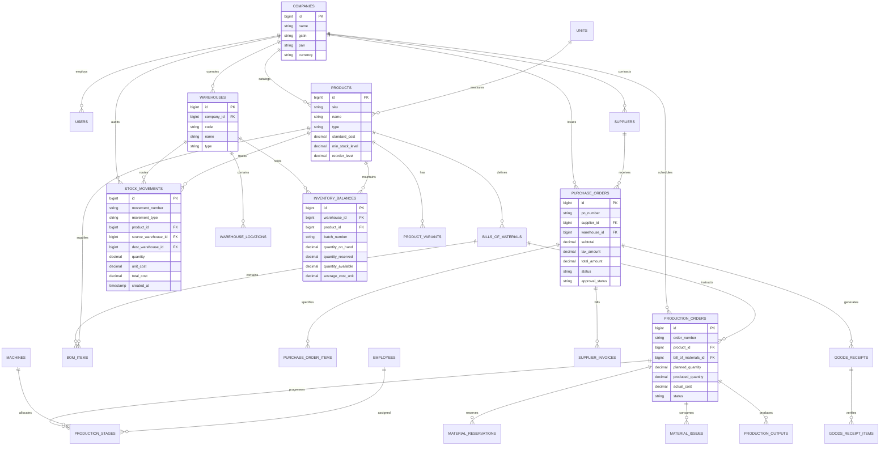

# ForgeFlow ERP - Relational Database Entity-Relationship Diagram

The ForgeFlow architecture enforces strict referential integrity, decimal precision for manufacturing weights and currency, and an immutable double-entry stock ledger.

## Immutable Double-Entry Ledger Principles

1. **Non-destructive Audit Ledger**: Once a row is written into `stock_movements`, Eloquent model events prevent any update or deletion.
2. **Row Locking (`lockForUpdate`)**: When adjusting or transferring stock, target `inventory_balances` records are locked inside a database transaction to prevent race conditions during concurrent shop floor issues.
3. **Negative Stock Prevention**: Stock on hand cannot drop below zero unless explicitly bypassed by an authorized system process.
4. **Weighted Average Valuation**: Every inbound movement re-computes `average_cost_unit = ((old_qty * old_cost) + (new_qty * new_cost)) / (old_qty + new_qty)`.

